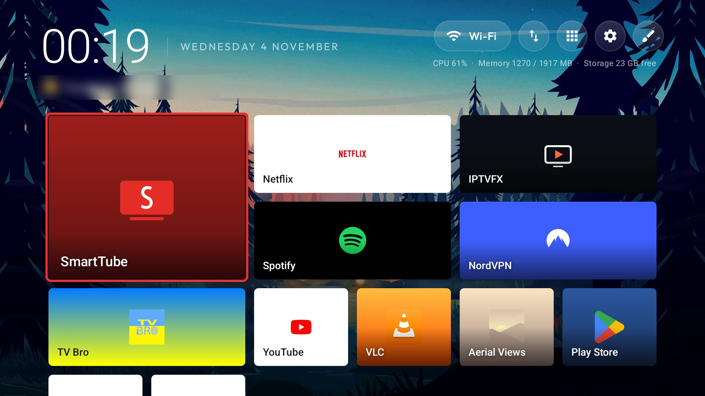
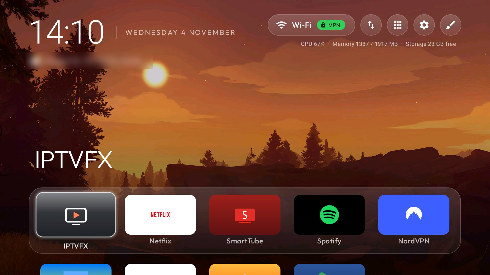
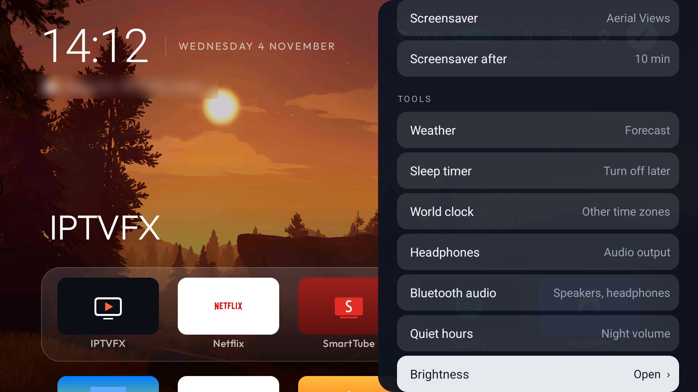

# Xiaomi TV Box S (3rd gen) — tested setup

Model MiTV-AFMU0 (codename twilight, Amlogic S905X5M), Google TV on Android 14. This folder is everything
used on that box: the debloat list, the theme, the Customize presets and the add-ons. Other Android TV and
Google TV devices work the same way; only `debloat.txt` is specific to this model.



| | |
|---|---|
|  |  |

## What you get

- **Clean Home**: the custom launcher **Custom TV Home** (`launcher/`, app id `com.anouarzerdeb.tvhome`) as Home, with the Google TV home, PatchWall, ads and
  telemetry switched off (disabled, never uninstalled, so everything can be undone).
- **Customize sidebar** (the brush button, top right): every option changes Home live behind it.
  - Layouts: Mosaic, Dock + grid, Single row, Grid; each shows only the settings that apply to it.
  - Background: live video, photos, night sky or black; change interval, dim, and *Background by time*
    (photos and videos sorted by brightness into morning, evening and night).
  - Mosaic: big card choice, focus effect (zoom, shine, pulse, border only), border in the app's colour,
    opening animation.
  - Clock 12/24 h, clock style (thin, bold, large, with seconds), date beside or below the time, greeting,
    animated weather icon (Rive), system stats.
  - Screensaver: Aerial Views, live video, photos or clock, and how long before it starts.
  - Design: preset looks; going back to *Custom* restores your own mix exactly.
  - **Tools**: each helper app on its own row (weather, sleep timer, world clock, Bluetooth audio,
    brightness, quiet hours, LocalSend, Key Mapper, Aerial Views…), kept off Home and the App library.
- **Remote buttons**: the YouTube button opens SmartTube, the Prime Video button opens an app of your
  choice, the TV+/Mi button opens NordVPN — all set in `config.json` → `app_keys`.

## Install on your box

You need a PC with [Android platform-tools](https://developer.android.com/tools/releases/platform-tools)
(`adb`) and, to build the launcher, Android Studio (its bundled JDK) or JDK 17 + Android SDK 34.

1. **Turn on debugging.** On the box: Settings → System → About → press *Android TV OS build* 7 times.
   Then Settings → System → Developer options → *USB debugging* on. Note the box's IP address
   (Settings → Network).
2. **Connect:** `adb connect <tv ip>:5555` and allow the PC on the TV.
3. **Back up first** (keep these files private, they identify your box):
   ```
   adb shell pm list packages -f > packages-all.txt
   adb shell pm list packages -d > packages-disabled.txt
   adb shell getprop > getprop.txt
   ```
4. **Build and install the launcher** (Windows, PowerShell, in `launcher/`):
   ```
   $env:JAVA_HOME = 'C:\Program Files\Android\Android Studio\jbr'
   .\gradlew.bat assembleRelease
   adb install -r app\build\outputs\apk\release\app-release.apk
   adb shell cmd package set-home-activity com.anouarzerdeb.tvhome/com.gathin.tvhome.MainActivity
   ```
   Press Home on the remote and choose the new launcher if asked.
5. **Give it its permissions** (accessibility helper for the remote buttons, screensaver choice, screensaver delay):
   ```
   adb shell pm grant com.anouarzerdeb.tvhome android.permission.WRITE_SECURE_SETTINGS
   adb shell appops set com.anouarzerdeb.tvhome WRITE_SETTINGS allow
   adb shell appops set com.anouarzerdeb.tvhome ACCESS_RESTRICTED_SETTINGS allow
   adb shell settings put secure enabled_accessibility_services com.anouarzerdeb.tvhome/com.gathin.tvhome.HomeKeyService
   adb shell settings put secure accessibility_enabled 1
   ```
6. **Push the theme** (open Home once first so its folder exists):
   ```
   adb push theme/config.json /sdcard/Android/data/com.anouarzerdeb.tvhome/files/config.json
   adb shell mkdir -p /sdcard/Android/data/com.anouarzerdeb.tvhome/files/themes
   adb push theme/presets/. /sdcard/Android/data/com.anouarzerdeb.tvhome/files/themes/
   ```
   Put your own pictures in `.../files/wallpapers/` and videos (MP4) in `.../files/videos/`.
   To show the weather, add `"weather_city": "Berlin", "weather_lat": "52.52", "weather_lon": "13.405"`
   (your city) or pick the city later in Customize. Edit `theme/config.json` first: `dock_apps`, `app_keys`, `hidden_apps` and `top_bar_apps` name packages
   from this box; change them to the apps on yours.
7. **Debloat in small batches** with `debloat.txt`, one package per command, checking the TV between
   batches:
   ```
   adb shell pm disable-user --user 0 <package>
   ```
   Read the notes in `debloat.txt`: on this box `com.google.android.tungsten.setupwraith` owns the saved
   Wi-Fi network; re-join Wi-Fi by hand before disabling it, or the box goes offline.
8. **Optional add-ons** listed in `addons.txt` (module-card apps from `addons/` and their own projects).
9. **Close debugging** when done: Developer options → USB debugging off.

## Undo everything

`restore.ps1 -TvHost <tv ip>` re-enables every package in `debloat.txt` and makes the Google TV home the
Home app again. Any single app: `adb shell pm enable <package>`.

## Tips

- After every launcher reinstall, run step 5 again: Android switches the remote-button helper off when
  the app is updated.
- A remote button handled by the helper must be tested with the real remote; `adb shell input keyevent`
  does not prove it works.
- Key codes of this remote are in `/vendor/usr/keylayout/Vendor_2717_Product_32b9.kl` on the box
  (Prime Video = scan 207 / `BUTTON_7`, YouTube = scan 425 / `BUTTON_3`).
